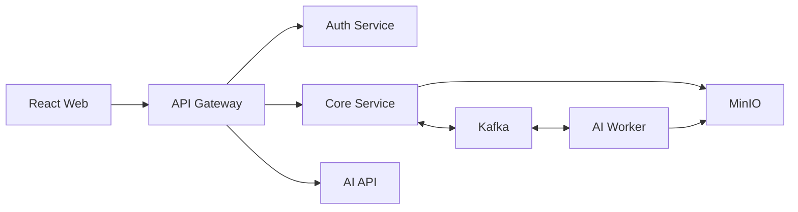

# Smart Recruitment

Hệ thống tuyển dụng hỗ trợ ứng viên quản lý CV, nhà tuyển dụng sàng lọc hồ sơ và theo dõi quá trình tuyển dụng. CV và mô tả công việc (JD) được phân tích thành dữ liệu có cấu trúc; kết quả đối chiếu đi kèm giải thích và bằng chứng từ tài liệu nguồn.

[Chức năng](#chức-năng) · [Kiến trúc](#kiến-trúc) · [Chạy local](#chạy-local) · [Kiểm thử](#kiểm-thử) · [Tài liệu](#tài-liệu)

## Chức năng

| Người dùng | Chức năng chính |
| --- | --- |
| Ứng viên | Tìm việc, quản lý hồ sơ, tải CV PDF, kiểm tra và sửa thông tin trích xuất, ứng tuyển và theo dõi trạng thái. |
| Nhà tuyển dụng | Quản lý công ty, tạo và xác nhận JD, đăng tin, xem hồ sơ ứng tuyển, kết quả đối chiếu và lịch sử xử lý. |
| Quản trị viên | Duyệt danh mục ngành nghề và kỹ năng, quản lý tên gọi/alias, xem lịch sử thay đổi. |

Ứng viên có thể rút đơn, thu hồi quyền chia sẻ hoặc xóa CV. Quyền truy cập tài liệu được kiểm tra theo tài khoản và hồ sơ ứng tuyển.

### Luồng tuyển dụng

1. Nhà tuyển dụng tạo JD, kiểm tra dữ liệu phân tích và xác nhận trước khi đăng tin CNTT.
2. Ứng viên tải CV; hệ thống trích xuất kỹ năng, kinh nghiệm, học vấn, ngoại ngữ, dự án và chứng chỉ. PDF scan có thể được xử lý bằng OCR Việt/Anh.
3. Ứng viên sửa và xác nhận kết quả, sau đó chọn CV để ứng tuyển và đồng ý chia sẻ hồ sơ.
4. Hệ thống đối chiếu CV với JD bất đồng bộ, trả điểm thành phần, giải thích và tham chiếu nguồn cho nhà tuyển dụng xem xét.
5. Nhà tuyển dụng cập nhật trạng thái; ứng viên theo dõi tiến trình trong workspace.

**Phạm vi AI:** đối chiếu và chấm điểm dành cho tuyển dụng CNTT. Công việc ngoài CNTT dùng quy trình xem xét hồ sơ thủ công. Điểm hỗ trợ sàng lọc; quyết định tuyển dụng thuộc người phụ trách.

## Kiến trúc



| Thành phần | Công nghệ | Trách nhiệm |
| --- | --- | --- |
| `web/` | React, TypeScript, Vite | Giao diện ứng viên, nhà tuyển dụng và quản trị. |
| `gateway-service/` | Spring Cloud Gateway | Định tuyến API, kiểm tra JWT, CORS và correlation ID. |
| `auth-service/` | Java 21, Spring Boot, jOOQ | Tài khoản, xác thực email, đăng nhập và quản lý phiên. |
| `core-service/` | Java 21, Spring Boot, jOOQ, Flyway | Hồ sơ, công ty, việc làm, ứng tuyển, danh mục nghề và quyền chia sẻ CV. |
| `ai-service/` | Python 3.12, FastAPI, SQLAlchemy, Alembic | Phân tích CV/JD, danh mục kỹ năng, xử lý tác vụ và đối chiếu hồ sơ. |
| Hạ tầng | PostgreSQL, Kafka, MinIO, Mailpit | Database, sự kiện, tài liệu riêng tư và email local. |

Auth, Core và AI sở hữu database riêng. Web gọi API qua Gateway; Core và AI trao đổi sự kiện qua Kafka. AI API và worker chạy thành hai process trong cùng image. Các tác vụ phân tích dùng outbox, xử lý lặp an toàn và retry có giới hạn. CV/JD và hồ sơ ứng tuyển giữ snapshot theo phiên bản.

Xem ranh giới service và các nguyên tắc dữ liệu tại [ARCHITECTURE.md](ARCHITECTURE.md).

## Chạy local

### Yêu cầu

- Git, Docker Engine hoặc Docker Desktop với Compose v2.
- OpenSSL trong `PATH` để tạo cặp khóa JWT cho môi trường local.
- Python 3.12 nếu muốn tạo dữ liệu demo bằng script.

Docker build các service và cài công cụ OCR. Java 21, Node.js 22 và Python 3.12 cần có trên máy khi phát triển hoặc chạy kiểm thử ngoài container.

### 1. Chuẩn bị cấu hình

Chạy các lệnh từ thư mục gốc repository. Tạo `.env` từ mẫu nếu chưa có, rồi thay **tất cả** giá trị `replace-me` bằng cấu hình local của bạn.

**Windows / PowerShell**

```powershell
Copy-Item .env.example .env
# Sửa các giá trị replace-me trong .env trước khi tiếp tục.
powershell -NoProfile -ExecutionPolicy Bypass -File scripts/generate-dev-jwt-keys.ps1
```

**Linux / macOS**

```bash
cp .env.example .env
# Sửa các giá trị replace-me trong .env trước khi tiếp tục.
./scripts/generate-dev-jwt-keys.sh
```

Khóa JWT được lưu tại `.local/secrets/`. Giữ nguyên khóa khi khởi động lại; script sẽ từ chối ghi đè khóa đã tồn tại. `.env` và khóa riêng tư không được đưa vào Git.

### 2. Khởi động

```bash
docker compose -f compose.yaml -f compose.dev.yaml up -d --build
docker compose -f compose.yaml -f compose.dev.yaml ps
```

| Địa chỉ | Mục đích |
| --- | --- |
| [localhost:5173](http://localhost:5173) | Giao diện Web. |
| [localhost:8080](http://localhost:8080/actuator/health) | Gateway; link mở endpoint kiểm tra sức khỏe. |
| [localhost:8025](http://localhost:8025) | Mailpit để xem email xác thực và khôi phục tài khoản. |
| [localhost:9001](http://localhost:9001) | MinIO Console; đăng nhập bằng cấu hình MinIO trong `.env`. |

`compose.dev.yaml` mở thêm cổng hạ tầng để phát triển. `compose.yaml` chỉ công bố Web và Gateway. PostgreSQL, Kafka và MinIO lưu dữ liệu bằng Docker volumes.

### 3. Dùng thử

Có thể đăng ký trên Web và xác thực email qua Mailpit. Để tạo sẵn tài khoản, công ty, JD, CV và hồ sơ ứng tuyển mẫu, chạy khi stack đã sẵn sàng:

```bash
python scripts/seed-demo.py
```

Trên Linux dùng `python3` nếu đó là tên interpreter Python 3.12. Script dùng Gateway API và tài liệu tổng hợp; có thể chạy lại với dữ liệu demo hiện có.

| Vai trò | Email demo | Mật khẩu demo |
| --- | --- | --- |
| Ứng viên | `candidate.demo@smart.local` | `DemoCandidate!2026` |
| Nhà tuyển dụng | `recruiter.demo@smart.local` | `DemoRecruiter!2026` |

Các tài khoản trên chỉ dành cho demo local. Có thể đổi bằng biến `DEMO_CANDIDATE_EMAIL`, `DEMO_CANDIDATE_PASSWORD`, `DEMO_RECRUITER_EMAIL` và `DEMO_RECRUITER_PASSWORD`. Seed không tạo tài khoản quản trị.

## Phân tích CV/JD và AI tùy chọn

Parser cục bộ và OCR hoạt động mà không cần API key. Groq/Gemini có thể hỗ trợ trích xuất; các provider đều **tắt mặc định**. Worker chỉ gọi provider khi phiên bản tài liệu có consent với policy hiện hành và còn hạn mức theo ngày/user.

Backend kiểm tra schema và đoạn trích với nguồn, sau đó chuẩn hóa dữ liệu bằng danh mục kỹ năng. Provider lỗi, hết hạn mức hoặc thiếu consent thì giữ kết quả cục bộ. Người dùng vẫn cần kiểm tra và xác nhận thông tin trích xuất.

- Cấu hình provider nằm trong [Settings](ai-service/app/shared/config.py); truyền biến `AI_*` vào process/container AI để bật theo môi trường của bạn.
- Consent cho AI bên ngoài độc lập với quyền chia sẻ CV cho nhà tuyển dụng. Bộ lọc thông tin liên hệ là biện pháp giảm dữ liệu gửi đi, không bảo đảm ẩn danh hoàn toàn.
- Điểm hiển thị được tính bằng baseline theo quy tắc và từ khóa. Semantic/hybrid là nhánh thử nghiệm đối chiếu riêng, chưa thay thế điểm của ứng dụng.

Kết quả kiểm thử chức năng không xác lập độ chính xác tuyển dụng. Đánh giá chất lượng cần dữ liệu và nhãn độc lập; xem [biểu mẫu đánh giá](evaluation/matching-annotation-template.csv) và [công cụ evaluation](ai-service/app/evaluation/).

## Kiểm thử

Chuẩn bị Java 21, Node.js 22, Python 3.12 và dependency trên máy. Ví dụ PowerShell, từ thư mục gốc:

```powershell
python -m venv .venv
.\.venv\Scripts\Activate.ps1
python -m pip install -c ai-service/requirements.lock -e "./ai-service[test]"
python -m pip install ruff mypy
npm --prefix web ci
```

Trên Linux/macOS, dùng `python3 -m venv .venv` và `source .venv/bin/activate`; các lệnh cài dependency còn lại tương tự.

| Phạm vi | Lệnh | Thư mục chạy |
| --- | --- | --- |
| Kiến trúc | `python scripts/validate-architecture.py` | Gốc repo |
| Contracts | `python -m pytest -q -p no:cacheprovider contracts/tests` | Gốc repo |
| Java | `.\auth-service\mvnw.cmd -f pom.xml test` | Gốc repo; Linux/macOS dùng `./auth-service/mvnw` |
| AI | `python -m pytest -q -p no:cacheprovider` | `ai-service/` |
| AI lint | `python -m ruff check app tests --no-cache` | `ai-service/` |
| AI typecheck | `python -m mypy app --follow-imports=silent --ignore-missing-imports` | `ai-service/` |
| Web | `npm test` và `npm run build` | `web/` |

Java integration tests dùng PostgreSQL Testcontainers và cần Docker hoạt động. Test AI yêu cầu PostgreSQL chỉ chạy khi được cấp database kiểm thử cô lập; kiểm tra báo cáo skip để biết phần chưa chạy. Web build gồm TypeScript và Vite; hiện chưa có lệnh lint riêng.

[verify.ps1](scripts/verify.ps1) và [verify.sh](scripts/verify.sh) chạy lần lượt kiểm tra kiến trúc, contracts, AI, Java và Web; lint/typecheck AI chạy riêng bằng lệnh trong bảng.

```powershell
powershell -NoProfile -ExecutionPolicy Bypass -File scripts/verify.ps1
```

```bash
./scripts/verify.sh
```

Sau khi stack đã chạy và có dữ liệu demo, kiểm tra luồng trình duyệt bằng Playwright trên máy:

```bash
cd web
npx playwright install chromium
npm run test:e2e
```

Một số ca cần tài khoản quản trị thử nghiệm qua `E2E_ADMIN_EMAIL` và `E2E_ADMIN_PASSWORD`. Kiểm tra kết quả skip khi chạy E2E.

## Tài liệu

| Nội dung | Nơi xem |
| --- | --- |
| Kiến trúc và ranh giới service | [ARCHITECTURE.md](ARCHITECTURE.md) |
| HTTP APIs, event schemas và ví dụ payload | [Contracts](contracts/), [OpenAPI](contracts/openapi/) |
| Dữ liệu có cấu trúc CV/JD và taxonomy | [Schemas](contracts/schemas/), [Taxonomy](contracts/taxonomy/) |
| Kiểm tra Gateway/Web đang chạy | [smoke-test.ps1](scripts/smoke-test.ps1), [smoke-test.sh](scripts/smoke-test.sh) |
| Kiểm tra OCR bằng PDF tổng hợp | [ocr-runtime-smoke.sh](scripts/ocr-runtime-smoke.sh) |
| Backup và diễn tập khôi phục local | [backup-local.sh](scripts/backup-local.sh), [restore-rehearsal.sh](scripts/restore-rehearsal.sh) |
