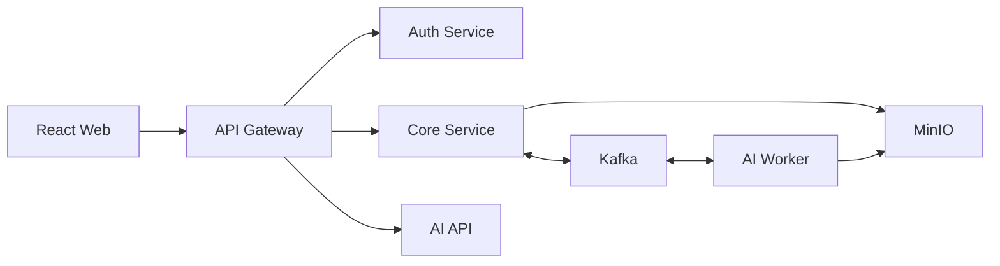

# Smart Recruitment

Hệ thống tuyển dụng hỗ trợ ứng viên quản lý CV, nhà tuyển dụng sàng lọc hồ sơ và theo dõi quá trình tuyển dụng. CV và mô tả công việc (JD) được phân tích thành dữ liệu có cấu trúc; kết quả đối chiếu đi kèm giải thích và bằng chứng từ tài liệu nguồn.

[Chức năng](#chức-năng) · [Kiến trúc](#kiến-trúc) · [Chạy local](#chạy-local) · [Kiểm thử](#kiểm-thử) · [Tài liệu](#tài-liệu)

## Chức năng

| Người dùng | Chức năng chính |
| --- | --- |
| Ứng viên | Tìm việc, quản lý hồ sơ, tải CV PDF, kiểm tra và sửa thông tin trích xuất, ứng tuyển và theo dõi trạng thái. |
| Nhà tuyển dụng | Quản lý công ty, tải logo và ảnh bìa, tạo và xác nhận JD, đăng tin, xem hồ sơ ứng tuyển, kết quả đối chiếu và lịch sử xử lý. |
| Quản trị viên | Duyệt công ty hoạt động, duyệt danh mục ngành nghề và kỹ năng, quản lý tên gọi/alias, xem lịch sử thay đổi. |

Giao diện khách tìm việc và ứng viên hỗ trợ mobile. Không gian nhà tuyển dụng và
quản trị viên dành cho laptop/desktop, với bố cục tối thiểu 1024 px và thanh điều
hướng cố định; màn hình dưới 1024 px hiển thị thông báo yêu cầu dùng máy tính kèm nút đăng xuất.

Ứng viên có thể cập nhật ảnh đại diện tài khoản bằng ảnh JPEG/PNG (tối đa 2 MiB) trong Hồ sơ, rút đơn, thu hồi quyền chia sẻ hoặc xóa CV. Quyền truy cập tài liệu được kiểm tra theo tài khoản và hồ sơ ứng tuyển.

### Tạo CV theo mẫu & Chỉnh sửa PDF trực tiếp

Trong **CV của tôi**, bạn có thể quản lý bản nháp/CV ở tab **CV & Bản nháp của tôi**, khám phá mẫu ở tab **Kho mẫu CV**, **Sửa file PDF trực tiếp**, hoặc chọn **Tạo CV theo mẫu** để mở trình soạn thảo WYSIWYG trực tiếp trên trang A4 với 4 mẫu bố cục (`Executive`, `Modern`, `Classic`, `Minimal`).

- **Trình soạn thảo CV (`CvBuilder`)**: chỉnh sửa trực tiếp từng mục trên tờ CV (kèm thanh định dạng nhanh **In đậm**, *In nghiêng*, `• Bullet`), đổi tên tiêu đề từng mục tự do, bảng điều khiển 4 tab (**Thiết kế**, **Bố cục mục**, **Gợi ý & Nhập**, **Hoàn thiện**), chọn font chữ (`Noto Sans`, `Noto Serif`, `Mono`), bảng màu & mã màu nhấn tùy chỉnh, cỡ chữ, giãn dòng, ngôn ngữ tiêu đề (`Tiếng Việt` / `English`), ngày sinh / giới tính, các mục mở rộng (**Giải thưởng**, **Hoạt động**, **Sở thích**), gợi ý viết CV mẫu, chấm điểm mức độ hoàn thiện, **cắt/xoay ảnh đại diện 1:1** cục bộ trên Canvas trình duyệt, tự động lưu bản nháp khi chỉnh sửa bản nháp đã lưu, phím tắt `Ctrl+S` / `Ctrl+Z` / `Ctrl+Y`, và **Hoàn tác / Làm lại**.
- **Nhập & đối chiếu PDF trong `CvBuilder`**: bạn có thể nhập tay, lấy thông tin từ hồ sơ cá nhân, chọn **Tinh chỉnh bằng CV Builder** từ CV đã phân tích trong thư viện, hoặc chọn **Nhập từ file PDF…** để đọc text PDF cục bộ ngay trên trình duyệt bằng `pdfjs-dist` kèm chế độ **PDF gốc đối chiếu** song song (lưu ý file ảnh scan chưa OCR cần dùng luồng phân tích AI hoặc **Sửa trực tiếp trên PDF**).
- **Trình sửa file PDF trực tiếp (`PdfOverlayEditor`)**: nhấn **Sửa file PDF trực tiếp** hoặc **Sửa trực tiếp trên PDF** trên thẻ CV để mở canvas trang PDF thật, đặt vùng **Che trắng**, chèn **Chữ tiếng Việt** (font SIL OFL `Noto Sans` nhúng qua `@pdf-lib/fontkit`) hoặc **Chèn ảnh / Chữ ký** với lịch sử Hoàn tác / Làm lại, sau đó tải xuống PDF đã chỉnh sửa hoặc lưu thành phiên bản CV mới vào thư viện.

Trình soạn thảo hỗ trợ **Tải xuống PDF** một chạm trực tiếp hoặc tạo **Bản xem trước PDF** (font Noto Sans & Noto Serif được phục vụ từ asset ứng dụng, không gửi dữ liệu CV tới dịch vụ tạo PDF bên ngoài) và **Lưu vào thư viện CV** sau bước xác nhận đồng ý chia sẻ. Bản nháp được lưu trên server (**Lưu bản nháp**, **Nhân bản**, mở lại hoặc xóa từ danh sách bản nháp) với khóa lạc quan chống ghi đè, đồng thời giữ tùy chọn **Tải file nháp** (`.cv.json`) và **Mở file nháp** để sao lưu cục bộ (hỗ trợ cả định dạng v1.0 cũ). Nội dung CV không được ghi vào `localStorage`. Bản CV gốc và hồ sơ ứng tuyển đã nộp không bị sửa bởi trình tạo CV.

### Luồng tuyển dụng

1. Nhà tuyển dụng tạo công ty và chuẩn bị JD nháp. Admin mở `/admin/companies`, kiểm tra công ty rồi duyệt hoạt động kèm lý do. Chỉ công ty `ACTIVE` được đăng tin; tin CNTT còn cần xác nhận dữ liệu phân tích JD.
2. Ứng viên tải CV; hệ thống trích xuất kỹ năng, kinh nghiệm, học vấn, ngoại ngữ, dự án và chứng chỉ. PDF scan có thể được xử lý bằng OCR Việt/Anh.
3. Ứng viên sửa và xác nhận kết quả, sau đó chọn CV để ứng tuyển và đồng ý chia sẻ hồ sơ.
4. Hệ thống đối chiếu CV với JD bất đồng bộ, trả điểm thành phần, giải thích và tham chiếu nguồn cho nhà tuyển dụng xem xét.
5. Nhà tuyển dụng xem xét CV và đưa hồ sơ vào danh sách rút gọn hoặc từ chối. Ứng viên theo dõi trạng thái trong workspace và có thể rút hồ sơ đang được xử lý.

Ứng viên có thể dùng tài khoản hiện có để nhận lời mời vào đội tuyển dụng nếu email đã xác minh trùng với email được mời. Sau khi chấp nhận, menu tài khoản trên máy tính cho phép chuyển giữa không gian Ứng viên và Nhà tuyển dụng. Quyền trong từng công ty do vai trò thành viên quyết định.

**Phạm vi AI:** đối chiếu và chấm điểm dành cho tuyển dụng CNTT. Công việc ngoài CNTT dùng quy trình xem xét hồ sơ thủ công. Điểm hỗ trợ sàng lọc; quyết định tuyển dụng thuộc người phụ trách.

## Kiến trúc



| Thành phần | Công nghệ | Trách nhiệm |
| --- | --- | --- |
| `web/` | React, TypeScript, Vite | Giao diện ứng viên, nhà tuyển dụng và quản trị. |
| `gateway-service/` | Spring Cloud Gateway | Định tuyến API, kiểm tra JWT, CORS và correlation ID. |
| `auth-service/` | Java 21, Spring Boot, jOOQ | Tài khoản, xác thực email, đăng nhập và quản lý phiên. |
| `core-service/` | Java 21, Spring Boot, jOOQ, Flyway | Hồ sơ, công ty, việc làm, ứng tuyển, danh mục nghề và quyền chia sẻ CV. |
| `ai-service/` | Python 3.12, FastAPI, SQLAlchemy, Alembic | Phân tích CV/JD, danh mục kỹ năng, xử lý tác vụ và đối chiếu hồ sơ. |
| Hạ tầng | PostgreSQL, Kafka, MinIO, Mailpit | Database, sự kiện, tài liệu riêng tư và email local. |

Auth, Core và AI sở hữu database riêng. Web gọi API qua Gateway; Core và AI trao đổi sự kiện qua Kafka. AI API và worker chạy thành hai process trong cùng image. Các tác vụ phân tích dùng outbox, xử lý lặp an toàn và retry có giới hạn. CV/JD và hồ sơ ứng tuyển giữ snapshot theo phiên bản.

AI hỗ trợ thử nghiệm 9Router bằng provider `router9`: cấu hình biến môi trường process
`AI_EXTRACTION_PROVIDER=router9`, `AI_ROUTER9_ENABLED=true`, `AI_ROUTER9_BASE_URL`,
`AI_ROUTER9_MODEL` (model hoặc combo ID) và `AI_ROUTER9_API_KEY` qua nơi quản lý secret.
Provider này tắt mặc định; model phải hỗ trợ JSON schema. Lỗi hoặc kết quả không có
bằng chứng nguồn sẽ quay về parser local. Consent và giới hạn ngân sách vẫn được áp dụng.
Endpoint local mặc định là `http://localhost:20128/v1`; trong container truy cập router
trên máy host dùng `http://host.docker.internal:20128/v1`, endpoint từ xa yêu cầu HTTPS.

Xem ranh giới service và các nguyên tắc dữ liệu tại [ARCHITECTURE.md](ARCHITECTURE.md).

### ID và nâng cấp dữ liệu cũ

Mỗi thực thể nghiệp vụ dùng một `BIGINT id` do database sở hữu cấp. API `/api/v2`, JWT `sub` và payload event v2 trả ID dưới dạng chuỗi thập phân, kể cả khi vượt giới hạn số nguyên an toàn của JavaScript. Frontend giữ ID là `string`. Event/correlation/evidence/lease vẫn dùng UUID kỹ thuật. ID phải đi kèm loại tài nguyên; CV và JD có thể cùng số ID.

Nâng cấp từ bản dùng UUID cần cửa sổ bảo trì đồng bộ, backup cả ba database và dừng các writer sau khi xử lý hết event v1 và lease reprocessing. Không chạy bản mới trực tiếp trên dữ liệu cũ khi chưa chuẩn bị mapping. Token truy cập UUID cũ sẽ bị từ chối; cần đăng nhập lại hoặc lấy token mới qua refresh.

1. Chạy Auth đến Flyway V7, Core **chỉ đến V25**, AI **chỉ đến Alembic 0019**. Các bước này lưu mapping UUID cũ → BIGINT hiện có; giữ nguyên migration lịch sử. Chưa khởi động API/worker mới.
2. Dùng `scripts/business-identity-map.py --url-env <tên-biến-URL> --service <auth|core|ai> export <file.json>` cho từng database riêng. Script cần SQLAlchemy và driver PostgreSQL từ môi trường AI; không đọc file môi trường hay in URL. File xuất chỉ chứa định danh.
3. Import file Auth và AI vào Core, file Auth và Core vào AI bằng cùng script với lệnh `import <file1.json> <file2.json>`. Mỗi lần chạy chỉ kết nối một database. Không có join hay khóa ngoại xuyên database.
4. Chạy Core đến V31 và AI đến 0020. Migration dừng và rollback nếu thiếu mapping; không tự đoán ID. ID chính BIGINT hiện có được giữ; bảng chỉ có UUID nhận sequence mới. Giữ mapping để đối chiếu sau nâng cấp. Batch reprocessing đang chạy được chuyển sang PAUSED; tạo preview mới vì hash snapshot cũ thay đổi sau chuyển ID.
5. Đồng bộ cấu hình Kafka/topic v2, Gateway, backend và Web, rồi kiểm tra luồng bằng dữ liệu tổng hợp. Đường dẫn UUID cũ không còn được hỗ trợ. Chỉ mở lại lưu lượng sau khi đối chiếu số lượng bản ghi, ownership, snapshot và event chờ. Nếu cần quay lại bản cũ, khôi phục backup đồng bộ; không reset database hay chạy downgrade phá dữ liệu.

Maven sinh jOOQ Core từ `db/codegen/core-schema.sql` vì bước chuyển dữ liệu dùng Java/Flyway. Sau khi đổi schema, cập nhật projection bằng `python scripts/generate-core-jooq-schema.py`; test database so sánh cột projection với schema PostgreSQL sau migration.

## Chạy local

### Yêu cầu

- Git, Docker Engine hoặc Docker Desktop với Compose v2.
- OpenSSL trong `PATH` để tạo cặp khóa JWT cho môi trường local.
- Python 3.12 nếu muốn tạo dữ liệu demo bằng script.

Docker build các service và cài công cụ OCR. Java 21, Node.js 22 và Python 3.12 cần có trên máy khi phát triển hoặc chạy kiểm thử ngoài container.

### 1. Chuẩn bị cấu hình

Chạy các lệnh từ thư mục gốc repository. Tạo `.env` từ mẫu nếu chưa có, rồi thay **tất cả** giá trị `replace-me` bằng cấu hình local của bạn.

**Windows / PowerShell**

```powershell
Copy-Item .env.example .env
# Sửa các giá trị replace-me trong .env trước khi tiếp tục.
powershell -NoProfile -ExecutionPolicy Bypass -File scripts/generate-dev-jwt-keys.ps1
```

**Linux / macOS**

```bash
cp .env.example .env
# Sửa các giá trị replace-me trong .env trước khi tiếp tục.
./scripts/generate-dev-jwt-keys.sh
```

Khóa JWT được lưu tại `.local/secrets/`. Giữ nguyên khóa khi khởi động lại; script sẽ từ chối ghi đè khóa đã tồn tại. `.env` và khóa riêng tư không được đưa vào Git.

### 2. Khởi động

```bash
docker compose -f compose.yaml -f compose.dev.yaml up -d --build
docker compose -f compose.yaml -f compose.dev.yaml ps
```

| Địa chỉ | Mục đích |
| --- | --- |
| [localhost:5173](http://localhost:5173) | Giao diện Web. |
| [localhost:8080](http://localhost:8080/actuator/health) | Gateway; link mở endpoint kiểm tra sức khỏe. |
| [localhost:8025](http://localhost:8025) | Mailpit để xem email xác thực và khôi phục tài khoản. |
| [localhost:9001](http://localhost:9001) | MinIO Console; đăng nhập bằng cấu hình MinIO trong `.env`. |

`compose.dev.yaml` mở cổng Gateway trên `localhost:8080` và các cổng hạ tầng để phát triển. Trên Coolify, proxy chuyển tiếp trực tiếp tới cổng `8080` trong container Gateway. PostgreSQL, Kafka và MinIO lưu dữ liệu bằng Docker volumes.

### 3. Dùng thử

Có thể đăng ký trên Web và xác thực email qua Mailpit. Để tạo sẵn tài khoản, công ty, JD, CV và hồ sơ ứng tuyển mẫu, chạy khi stack đã sẵn sàng:

```bash
python scripts/seed-demo.py
```

Trên Linux dùng `python3` nếu đó là tên interpreter Python 3.12. Script dùng Gateway API và tài liệu tổng hợp; có thể chạy lại với dữ liệu demo hiện có.

Để tạo portal mẫu gồm **8 công ty và 11 JD**, dùng fixture `scripts/seed-portal-data.json` và seed API v2 mới:

```bash
python scripts/seed-portal.py --dry-run
python scripts/seed-portal.py
```

Script hỏi mật khẩu tài khoản recruiter demo; có thể dùng `--password-env <tên-biến>` cho môi trường tự động. Chỉ nhận địa chỉ Gateway/Mailpit loopback, không đọc file `.env`, không kết nối SQL hay gọi Docker. Các công ty có slug `demo-portal-*` và nhãn Demo. ID do backend/database cấp, giữ dạng chuỗi số; chạy lại sẽ tiếp tục các bản ghi đã tạo mà không ghi đè dữ liệu hiện có. `--draft-only` chỉ tạo bản nháp, không chờ AI worker. `run_seed_sql.py` được giữ làm lệnh tương thích và gọi cùng seed API mới; file SQL UUID cũ đã được thay bằng fixture JSON.

Với công ty demo mới, chạy `python scripts/seed-portal.py --draft-only` để tạo công ty và JD nháp, sau đó dùng tài khoản Admin duyệt tại `/admin/companies`. Chạy lại seed không có `--draft-only` để chờ phân tích, xác nhận JD và đăng tin. Nếu chưa duyệt công ty, yêu cầu đăng tin bị từ chối và dữ liệu đã tạo vẫn được giữ. Dữ liệu tổng hợp luôn tắt đồng ý gửi ra AI bên ngoài; seed không tự duyệt công ty hoặc gán nhãn đã xác minh. Nếu kiểm tra độ phù hợp trước khi nộp báo `JD_NOT_FOUND`, cần hoàn tất luồng phân tích/xác nhận JD; chèn thẳng tin ở trạng thái `PUBLISHED` không tạo dữ liệu phân tích.

Bộ mở rộng `scripts/seed-portal-expanded.json` thêm **12 công ty và 24 tin CNTT demo**,
tham khảo hồ sơ công khai trên ITviec, TopCV và Saramin (4 công ty mỗi nguồn).
Mỗi công ty có logo và ảnh bìa WebP lưu tại `web/public/companies/seed-expanded/`.
Nguồn ảnh, trang tham khảo, ngày đối chiếu và SHA-256 nằm trong
`scripts/seed-portal-expanded.sources.json`. Mô tả JD và điều kiện tuyển dụng được
viết mới cho demo; không xác nhận là tin tuyển dụng chính thức hay sao chép toàn văn.
Các tin ẩn lương dùng lương thỏa thuận; trường website của hồ sơ demo liên kết
đến trang tuyển dụng tham khảo. Logo/ảnh giữ quyền sở hữu của chủ thể nguồn.

```bash
python scripts/seed-portal.py --data scripts/seed-portal-expanded.json --dry-run
python scripts/seed-portal.py --data scripts/seed-portal-expanded.json
```

Seed mở rộng dùng cùng Gateway API v2 và quy trình phân tích/xác nhận JD;
chạy lại tiếp tục dữ liệu hiện có, không ghi đè công ty hay tạo trùng tin.
Công ty mới tạo qua API ở trạng thái `PENDING`. Admin duyệt hoạt động qua
`/admin/companies` (API `POST /api/v2/dashboard/companies/{companyId}/approve`),
kèm phiên bản hiện tại và lý do; lịch sử lưu người duyệt và thời gian.
Chỉ công ty `ACTIVE` và tin đang mở mới xuất hiện công khai hoặc nhận đơn mới.
Tin đã đăng của công ty chưa ACTIVE được giữ nhưng tạm ẩn cho đến khi duyệt.
Duyệt hoạt động không đổi trạng thái xác minh thành `VERIFIED`.
Với bộ seed mở rộng, thêm `--draft-only` ở lượt đầu, duyệt các công ty rồi chạy lại cùng bộ dữ liệu để đăng tin.

Để nạp **bộ dữ liệu showcase thực tế trọn gói** (`scripts/seed-showcase-data.json`: cây danh mục CNTT & 6 ngành ngoài CNTT, 42 kỹ năng CNTT bổ sung, **21 doanh nghiệp** gồm 20 `ACTIVE` + 1 `PENDING`, **53 tin tuyển dụng** chuẩn HTML có tỉnh/thành & lương VND, **8 ứng viên**, **9 CV PDF**, **2 bản nháp CV Builder tiếng Việt** và **22 đơn ứng tuyển** trải đều 7 cột Kanban có điểm đối sánh AI), chạy:

```bash
python scripts/seed-showcase.py --dry-run
# Local dev (Gateway cổng 8080 + bootstrap tài khoản qua container postgres):
python scripts/seed-showcase.py --auto-postgres --gateway-url http://127.0.0.1:8080
```

Trên máy chủ **Ubuntu chạy Coolify** (khi `SMTP_HOST` đã trỏ ra SMTP thật nên không gửi mail xác minh cho `@smart.local`, và cổng nội bộ `127.0.0.1:5173` của Nginx chuyển `/api/` tới Gateway):

```bash
python3 scripts/seed-showcase.py --auto-postgres --gateway-url http://127.0.0.1:5173
```

Có thể truyền thêm `--grant-admin-email <email-của-bạn>` để cấp quyền `SYSTEM_ADMIN` cho tài khoản thật bạn đã đăng nhập trên Coolify, hoặc đặt mật khẩu riêng qua `SHOWCASE_ADMIN_PASSWORD`, `SHOWCASE_RECRUITER_PASSWORD`, `SHOWCASE_CANDIDATE_PASSWORD`. Chạy lại script an toàn (idempotent), không tạo trùng công ty, tin tuyển dụng, CV hay đơn ứng tuyển. Toàn bộ hồ sơ ứng viên/CV trong fixture là dữ liệu hư cấu không chứa thông tin cá nhân thật và không gắn chữ `Demo` trên tên/nội dung hiển thị.

| Bộ script | Vai trò | Email mặc định | Mật khẩu mặc định |
| --- | --- | --- | --- |
| `seed-showcase.py` | Quản trị | `quantri@smart.local` | `SmartAdmin!2026` |
| `seed-showcase.py` | Nhà tuyển dụng | `tuyendung@smart.local` | `SmartRecruiter!2026` |
| `seed-showcase.py` | Ứng viên chính (liên kết được Google Sign-In) | `nguyenquangit1612@gmail.com` | `SmartCandidate!2026` |
| `seed-demo.py` / `seed-portal.py` | Ứng viên / Recruiter | `candidate.demo@smart.local` / `recruiter.demo@smart.local` | `DemoCandidate!2026` / `DemoRecruiter!2026` |

Trên server công khai hãy đổi mật khẩu qua biến môi trường trước khi chạy `seed-showcase.py`. Các script `seed-demo.py` và `seed-portal.py` không tự tạo tài khoản quản trị.

## Chuẩn bị Coolify trên Ubuntu

Dùng **Docker Compose từ Git**, nhánh muốn triển khai, base directory là root repo và
Compose location là `compose.yaml`. Gán domain HTTPS cho service `web` ở cổng nội bộ
`80`; Nginx của Web chuyển `/api/` tới Gateway trong cùng Compose network. Hai cổng
host `5173`/`8080` chỉ bind vào loopback để không mở HTTP trực tiếp ra Internet.
Không dùng `compose.dev.yaml` trên server. `kafka-init` là tác vụ một lần với
`restart: "no"`.

Điền các biến sau trong **Environment Variables** của ứng dụng Compose trên Coolify,
không đưa giá trị thật vào Git hoặc file mẫu:

| Nhóm | Biến cần đặt |
| --- | --- |
| Database và object storage | `POSTGRES_ADMIN_PASSWORD`, `AUTH_DB_PASSWORD`, `CORE_DB_PASSWORD`, `AI_DB_PASSWORD`, `MINIO_ROOT_USER`, `MINIO_ROOT_PASSWORD`; chọn `POSTGRES_VOLUME_NAME` riêng nếu cùng server có stack khác. |
| URL công khai | `WEB_ORIGIN=https://app.example.com`, `AUTH_JWT_ISSUER` (một HTTPS issuer ổn định). Ba link xác minh email, đặt lại mật khẩu và lời mời công ty mặc định lấy từ `WEB_ORIGIN`; chỉ đặt `AUTH_EMAIL_VERIFICATION_BASE_URL`, `AUTH_EMAIL_PASSWORD_RESET_BASE_URL`, `CORE_EMAIL_COMPANY_INVITATION_BASE_URL` khi cần đường dẫn khác. |
| Email gửi đi | `SMTP_HOST`, `SMTP_PORT`, `SMTP_USERNAME`, `SMTP_PASSWORD`, `AUTH_EMAIL_FROM`, `CORE_EMAIL_FROM`; với SMTP cổng 587 thường đặt `SMTP_AUTH=true`, `SMTP_STARTTLS=true`, `SMTP_STARTTLS_REQUIRED=true`, `SMTP_SSL=false`. Với SMTP SSL cổng 465, dùng `SMTP_SSL=true` và `SMTP_STARTTLS=false` theo hướng dẫn nhà cung cấp. |
| Khóa JWT | `AUTH_JWT_PRIVATE_KEY_FILE`, `AUTH_JWT_PUBLIC_KEY_FILE`: đường dẫn tuyệt đối tới hai file PEM bền vững trên host Ubuntu. Tạo file trên server trước khi deploy, giữ khóa riêng tư ngoài repo và mount chỉ đọc. Không sinh lại khóa khi redeploy. |

Đánh dấu các mật khẩu/credential là **secret** trong Coolify. `SMTP_HOST` mặc định là
`mailpit` để chạy local; trên Coolify phải thay bằng SMTP thật nếu muốn người dùng
nhận email. Mailpit vẫn tồn tại nội bộ trong Compose nhưng không dùng cho gửi mail
khi `SMTP_HOST` đã đổi. `WEB_ORIGIN` phải dùng đúng domain HTTPS; không giữ giá trị
`localhost` của `.env.example`. Nếu các biến URL email đã có giá trị trong Coolify,
cập nhật chúng theo domain thật vì giá trị đã đặt sẽ ghi đè mặc định từ `WEB_ORIGIN`.

Trước khi mở cho người dùng: kiểm tra backup của PostgreSQL/MinIO, các migration,
trạng thái container và luồng đăng ký → nhận mail → xác minh → đăng nhập trên domain
thật. Nếu server có dữ liệu từ bản UUID cũ, làm quy trình nâng cấp ID ở phần kiến trúc
trước khi chạy migration bản mới; không khởi động trực tiếp lên database đó.

## Dữ liệu hiển thị trên portal

Portal đọc công ty và việc làm qua Gateway API v2. `GET /api/v2/public/jobs/discovery`
tổng hợp địa điểm và nhóm nghề từ toàn bộ tin đã đăng, chưa hết hạn; không phụ thuộc
12 tin mới nhất trên trang chủ. Chọn nhóm nghề lọc theo ID ngành/chuyên môn. Gợi ý
kỹ năng được dò từ nội dung tin mới, không phải số liệu xu hướng hay kết quả AI đã xác nhận;
tin không có từ khóa phù hợp không được tự gán kỹ năng. Logo/ảnh doanh nghiệp dùng
URL đã lưu, thiếu ảnh hiển thị hình giữ chỗ. Dữ liệu do các script seed tạo vẫn là demo,
kể cả khi đã lưu trong database; hệ thống không tự lấy tin tuyển dụng bên ngoài.

Chọn một tin trên portal mở trang chi tiết riêng qua tham số `job` trên URL,
gồm nội dung tuyển dụng, đối chiếu CV trong trang, thông tin công ty và các tin
khác cùng công ty từ API. Link có thể chia sẻ/tải lại; nút quay lại giữ bộ lọc tìm kiếm.

Hồ sơ công ty dùng URL `?view=companies&company=<id>`: ảnh bìa, logo, phần giới thiệu
và thông tin do công ty cung cấp nằm trước danh sách tin đang mở có phân trang.
Các link công ty cũ từ trang tìm kiếm vẫn mở được hồ sơ này. Trang tìm kiếm dùng
thanh tìm kiếm/bộ lọc theo dữ liệu API và danh sách tin; chọn tin mở trang chi tiết,
không tự mở khung xem trước. Bộ lọc và trang kết quả được giữ trong URL.

## Đăng nhập Google

Trang đăng nhập/đăng ký hỗ trợ nút Google Identity Services (popup). Google Cloud cần một
OAuth client loại **Web application**, với Authorized JavaScript origins gồm
`http://localhost` và `http://localhost:5173` khi chạy local; thêm origin HTTPS thật khi triển khai.
Luồng popup không cần Authorized redirect URI hoặc Client Secret. Cấu hình consent/branding
và tài khoản thử nghiệm trong Google Auth Platform theo môi trường của bạn.

Auth Service có Client ID công khai của dự án làm mặc định trong `application.properties`.
Biến process/container `AUTH_GOOGLE_CLIENT_ID` ghi đè giá trị này; đặt chuỗi rỗng để tắt Google.
Web lấy Client ID từ Gateway nên không cần cấu hình riêng hoặc đưa Client Secret vào frontend.
Sau khi cập nhật code, build/restart các service bị ảnh hưởng theo quy trình local của bạn;
chỉ sửa file `.env` trên host không tự cập nhật môi trường container đang chạy.

Auth xác minh chữ ký Google, issuer, audience, thời hạn, email đã xác minh và nonce dùng một lần
có hạn 5 phút. Auth lưu Google `sub`, không lưu ID token Google. Sau đó Auth cấp JWT/refresh token
của hệ thống và giữ nguyên cơ chế xoay vòng/thu hồi phiên.

- Tài khoản mới ở trang đăng nhập mặc định là ứng viên. Khi đăng ký có thể chọn nhà tuyển dụng;
  lựa chọn này không thay đổi vai trò của tài khoản đã tồn tại.
- Với tài khoản chưa có hồ sơ ở Core, đăng nhập Google trích xuất tên hiển thị, email và
  URL ảnh đại diện HTTPS (`picture`, cho ứng viên) từ ID token đã xác minh để khởi tạo
  hồ sơ lần đầu mà không lưu vào Auth DB và không ghi đè hồ sơ đã tồn tại.
- Khi đăng nhập Google với email Gmail hoặc Google Workspace trùng email đã đăng ký, tài khoản `ACTIVE` đã xác minh email được tự động liên kết và giữ nguyên mật khẩu. Tài khoản `PENDING` được xác minh, kích hoạt và xóa mật khẩu lúc đăng ký. Cả hai trường hợp giữ nguyên vai trò và hồ sơ. Tài khoản bị vô hiệu hóa hoặc đã liên kết với một Google `sub` khác sẽ bị từ chối. Với email bên thứ ba, hãy xác minh qua email nếu cần, rồi đăng nhập bằng mật khẩu và liên kết Google trong phần bảo mật tài khoản.
- Tài khoản chỉ dùng Google có thể tạo mật khẩu qua **Quên mật khẩu** và liên kết gửi tới email.
- Migration Auth `V5__google_sign_in.sql` bổ sung bảng identity/challenge, giữ nguyên dữ liệu cũ.
  Backend cần truy cập HTTPS tới JWKS của Google; trình duyệt cần tải `accounts.google.com/gsi/client`.

Contract: [Google Auth v2](contracts/openapi/google-auth-v2.yaml).
Tài liệu Google: [cấu hình](https://developers.google.com/identity/gsi/web/guides/get-google-api-clientid),
[xác minh ID token](https://developers.google.com/identity/gsi/web/guides/verify-google-id-token).

## Phân tích CV/JD và AI tùy chọn

Parser cục bộ và OCR hoạt động mà không cần API key. Groq/Gemini có thể hỗ trợ trích xuất; các provider đều **tắt mặc định**. Worker chỉ gọi provider khi phiên bản tài liệu có consent với policy hiện hành và còn hạn mức theo ngày/user.

Backend kiểm tra schema và đoạn trích với nguồn, sau đó chuẩn hóa dữ liệu bằng danh mục kỹ năng. Provider lỗi, hết hạn mức hoặc thiếu consent thì giữ kết quả cục bộ. Người dùng vẫn cần kiểm tra và xác nhận thông tin trích xuất.

- Cấu hình provider nằm trong [Settings](ai-service/app/shared/config.py); truyền biến `AI_*` vào process/container AI để bật theo môi trường của bạn.
- Consent cho AI bên ngoài độc lập với quyền chia sẻ CV cho nhà tuyển dụng. Bộ lọc thông tin liên hệ là biện pháp giảm dữ liệu gửi đi, không bảo đảm ẩn danh hoàn toàn.
- Điểm nội bộ được tính bằng baseline theo quy tắc và từ khóa. Semantic/hybrid là nhánh thử nghiệm đối chiếu riêng, chưa thay thế điểm của ứng dụng.
- Giao diện biểu diễn mức độ phù hợp CV–JD bằng 1–5 sao nguyên: điểm nội bộ dưới 20 → 1 sao, từ 20 đến dưới 40 → 2 sao, từ 40 đến dưới 60 → 3 sao, từ 60 đến dưới 80 → 4 sao, từ 80 đến 100 → 5 sao. Điểm gốc vẫn được giữ để tính toán, sắp xếp và nghiên cứu; từng tiêu chí áp dụng cùng quy đổi sau khi đưa về thang 100. Thiếu dữ liệu không hiển thị sao; kết quả cần kiểm tra thêm vẫn có cảnh báo. Các khoảng này là quy ước hiển thị, chưa phải ngưỡng được xác lập bằng nhãn đánh giá độc lập.

Kết quả kiểm thử chức năng không xác lập độ chính xác tuyển dụng. Đánh giá chất lượng cần dữ liệu và nhãn độc lập; xem [biểu mẫu đánh giá](evaluation/matching-annotation-template.csv) và [công cụ evaluation](ai-service/app/evaluation/).

Công cụ evaluation hỗ trợ nghiên cứu một người chấm bằng tùy chọn
`prepare --annotation-provenance HUMAN_SINGLE_RATER`. Kit chỉ tạo `rater-1.csv`;
`status`, `evaluate` và `comparison` dùng đúng file này, ghi rõ giới hạn single-rater
và không tính độ đồng thuận giữa người chấm. Không sao chép một bộ nhãn thành hai
người chấm hoặc adjudication giả. Các kit hai người chấm hiện có giữ quy trình cũ.

Trước khi so baseline, semantic và hybrid trên dữ liệu đã được phép sử dụng,
dùng `python -m app.evaluation.kit freeze --source-kit <kit> --output <kit-moi>`
trong môi trường AI. Thêm `--ocr-enabled --ocr-max-pages 5 --ocr-timeout-seconds 60`
khi cần OCR; kiểm tra phương thức trích xuất và quality flags thực tế vì bật OCR
không bảo đảm runtime có đủ công cụ. Lệnh tạo kit mới, giữ nguyên nhãn nguồn và lưu
payload riêng ở `model-only/inputs.json`. `score`, `semantic` và `comparison` dùng
cùng snapshot và từ chối dữ liệu bị thay đổi; prediction/metric ghi hash đầu vào.
Kit cũ vẫn chạy theo `LEGACY_TEXT_ONLY` và metric có cảnh báo `INPUTS_NOT_FROZEN`.
Snapshot có thể chứa bằng chứng từ tài liệu, chưa được coi là ẩn danh; giữ local
và không đưa thư mục `model-only` cho người chấm.

Parsing có schema gold riêng tại [parsing-gold-v1.schema.json](contracts/schemas/parsing-gold-v1.schema.json).
Trong môi trường AI, dùng `python -m app.evaluation.parsing prepare --kit <kit> --taxonomy ../contracts/taxonomy/it-skills-v2.seed.json --output <gold-moi.json>`
để tạo template trống. `status --kit <kit> --gold <gold.json>` kiểm cấu trúc/tiến độ;
`evaluate --kit <frozen-kit> --gold <gold.json> --split dev --output <metrics-moi.json>`
chỉ chấm trên parsed snapshot đã khóa, không parse lại PDF hoặc gọi provider.
Nguồn/taxonomy/split/phạm vi trang phải khớp; UNKNOWN/NOT_REVIEWED không tự trở thành nhãn đã chấm.
Metric gồm skill extraction/normalization, distinct title và exact interval tháng/current;
education/languages/projects/certificates chưa được chấm metric. UNREADABLE/PARTIAL và interval thiếu
tháng có mẫu số/exclusions riêng, metric không xác định là null. Template giữ provenance UNKNOWN
đến khi người chấm xác nhận nguồn nhãn; kết quả một người chấm ghi rõ giới hạn đó.
Format JSON mới không tự nhập hay sửa file parsing-labels.csv cũ. Gold đã điền là dữ liệu riêng tư,
không đưa vào Git hoặc dùng metric từ fixture tổng hợp làm kết quả thực nghiệm.

Để phân tích sai số theo từng tiêu chí của baseline, sau `score` trên frozen kit dùng
`python -m app.evaluation.components --kit <frozen-kit> --output <frozen-kit>/model-only/components-baseline.json`.
Lệnh kiểm hash đầu vào/prediction và tính lại để đối chiếu đúng điểm đã lưu; không mở lại PDF,
không gọi provider, không ghi đè file. JSON `matching-components/1.0` gồm từng cặp/split, điểm tổng,
weight/score/contribution của từng tiêu chí, quality flags, mốc tính và hash nguồn/thuật toán.
Không xuất raw text, details, claims hoặc lý do gán nhãn. Đây vẫn là output riêng tư có ID nghiên cứu,
không đưa cho người chấm blind; không phải accuracy, dữ liệu ẩn danh được xác minh hay phân rã điểm semantic/hybrid.

Thêm `--variant semantic` hoặc `--variant hybrid` để xuất phân rã phương pháp ở định dạng
`matching-components/1.1`, sau một lượt semantic/comparison mới trên frozen kit. Export kiểm
model/revision, hash mã baseline/semantic, input/prediction và cấu hình20%; không tải model hay tính
lại embedding. Hybrid ghi đóng góp baseline80%/semantic20%; khi thiếu text dùng100% baseline,
semantic là `null` trong breakdown và có cờ không khả dụng. Điểm0 của semantic CSV lúc thiếu text
chỉ là placeholder của policy nghiên cứu, không được diễn giải là độ phù hợp0 đã đo được.
`baselineComponents` trong hybrid là chẩn đoán baseline gốc, không phải điểm từng kỹ năng đã phân bổ
cho hybrid; cosine chưa được phân rã theo kỹ năng. Experiment cũ thiếu hash mã cần chạy lại vào kit/run mới,
không sửa metadata cũ để giả tạo lineage. Export không xác minh lại phép tính cosine từ model.

Comparison với frozen inputs tự lưu `model-only/components-<variant>.json` và hash/schema trong
`run.json.componentArtifacts`. Model local không khả dụng thì chỉ xuất baseline thật; kit legacy text-only
giữ cách chạy cũ và không tự tạo component artifact. Nhãn người và metric chất lượng vẫn là bước riêng.

## Kiểm thử

Chuẩn bị Java 21, Node.js 22, Python 3.12 và dependency trên máy. Ví dụ PowerShell, từ thư mục gốc:

```powershell
python -m venv .venv
.\.venv\Scripts\Activate.ps1
python -m pip install -c ai-service/requirements.lock -e "./ai-service[test]"
python -m pip install ruff mypy
npm --prefix web ci
```

Trên Linux/macOS, dùng `python3 -m venv .venv` và `source .venv/bin/activate`; các lệnh cài dependency còn lại tương tự.

| Phạm vi | Lệnh | Thư mục chạy |
| --- | --- | --- |
| Kiến trúc | `python scripts/validate-architecture.py` | Gốc repo |
| Contracts | `python -m pytest -q -p no:cacheprovider contracts/tests` | Gốc repo |
| Java | `.\auth-service\mvnw.cmd -f pom.xml test` | Gốc repo; Linux/macOS dùng `./auth-service/mvnw` |
| AI | `python -m pytest -q -p no:cacheprovider` | `ai-service/` |
| AI lint | `python -m ruff check app tests --no-cache` | `ai-service/` |
| AI typecheck | `python -m mypy app --follow-imports=silent --ignore-missing-imports` | `ai-service/` |
| Web | `npm test` và `npm run build` | `web/` |

Java integration tests dùng PostgreSQL Testcontainers và cần Docker hoạt động. Test AI yêu cầu PostgreSQL chỉ chạy khi được cấp database kiểm thử cô lập; kiểm tra báo cáo skip để biết phần chưa chạy. Web build gồm TypeScript và Vite; hiện chưa có lệnh lint riêng.

[verify.ps1](scripts/verify.ps1) và [verify.sh](scripts/verify.sh) chạy lần lượt kiểm tra kiến trúc, contracts, AI, Java và Web; lint/typecheck AI chạy riêng bằng lệnh trong bảng.

```powershell
powershell -NoProfile -ExecutionPolicy Bypass -File scripts/verify.ps1
```

```bash
./scripts/verify.sh
```

Sau khi stack đã chạy và có dữ liệu demo, kiểm tra luồng trình duyệt bằng Playwright trên máy:

```bash
cd web
npx playwright install chromium
npm run test:e2e
```

Suite E2E yêu cầu email/password tài khoản QA được truyền rõ qua
`E2E_CANDIDATE_EMAIL`, `E2E_CANDIDATE_PASSWORD`, `E2E_RECRUITER_EMAIL` và `E2E_RECRUITER_PASSWORD`;
test code không tự chọn credential demo mặc định. Chỉ trỏ `E2E_BASE_URL` đến stack QA đã được phép dùng.
Một số ca cần tài khoản quản trị thử nghiệm qua `E2E_ADMIN_EMAIL` và `E2E_ADMIN_PASSWORD`,
hoặc metadata fixture retry qua `E2E_RETRY_*`. Kiểm tra kết quả skip; thiếu fixture không được coi là ca đã đạt.

## Bản cài Android và Windows

`web/` có cấu hình Capacitor cho Android và Electron cho Windows. Cả hai đóng gói
giao diện React; Gateway, Auth, Core và AI vẫn chạy trên server. Trước khi tạo bản
dùng thực tế, triển khai Gateway qua HTTPS và đặt `VITE_GATEWAY_URL` thành origin
của Gateway khi build Web. Gateway phải cho phép origin của app theo cấu hình CORS;
đường dẫn `localhost` trên điện thoại trỏ về chính điện thoại. Chưa có Gateway
công khai thì file cài chỉ dùng để xem giao diện, không đăng nhập hoặc tải dữ liệu.

Trong `web/` trên Windows, sau khi đã cài dependencies:

```powershell
$env:VITE_GATEWAY_URL = 'https://gateway.example.com' # thay bằng Gateway thật
npm run build
npm run android:sync
cd android
.\gradlew.bat assembleDebug
```

APK thử nghiệm nằm tại `web/android/app/build/outputs/apk/debug/app-debug.apk`.
Android Studio/SDK và JDK tương thích phải được cài. Bản phát hành cần ký bằng
keystore riêng; không đưa keystore vào repository. Để tạo EXE portable từ `web/`:

```powershell
$env:VITE_GATEWAY_URL = 'https://gateway.example.com' # thay bằng Gateway thật
npm run desktop:package
```

File EXE nằm trong `web/release/`. Bản local chưa ký mã. Kiểm thử Google sign-in,
PDF và liên kết xác minh email trên thiết bị trước khi phát hành; Google sign-in
hiện dùng popup dành cho Web. Recruiter/Admin vẫn cần màn hình từ 1024 px.

## Tài liệu

| Nội dung | Nơi xem |
| --- | --- |
| Kiến trúc và ranh giới service | [ARCHITECTURE.md](ARCHITECTURE.md) |
| HTTP APIs, event schemas và ví dụ payload | [Contracts](contracts/), [OpenAPI](contracts/openapi/) |
| Dữ liệu có cấu trúc CV/JD và taxonomy | [Schemas](contracts/schemas/), [Taxonomy](contracts/taxonomy/) |
| Kiểm tra Gateway/Web đang chạy | [smoke-test.ps1](scripts/smoke-test.ps1), [smoke-test.sh](scripts/smoke-test.sh) |
| Kiểm tra OCR bằng PDF tổng hợp | [ocr-runtime-smoke.sh](scripts/ocr-runtime-smoke.sh) |
| Backup và diễn tập khôi phục local | [backup-local.sh](scripts/backup-local.sh), [restore-rehearsal.sh](scripts/restore-rehearsal.sh) |
